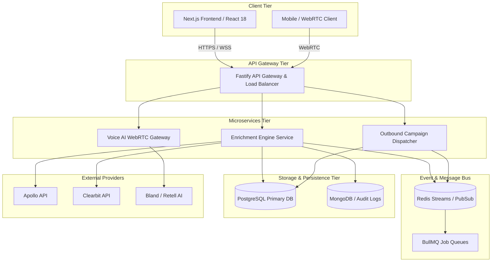
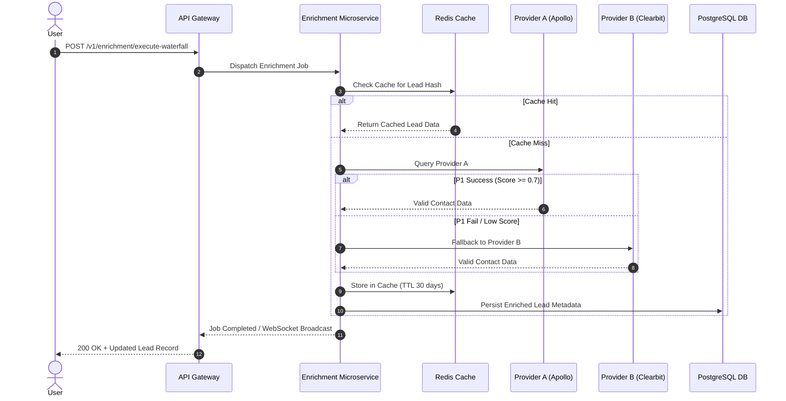

# VYUHOX_SOLUTION_ARCHITECTURE.md

**CONFIDENTIAL & PROPRIETARY**  
**TO:** Executive Leadership & Engineering Board, VYUHOX  
**FROM:** AGENT 5: Solution Architect  
**DATE:** October 2023  
**SUBJECT:** Comprehensive Technical Implementation & System Architecture Specification  

---

## 1. Current Architecture Assessment vs Target Architecture

### Current As-Is Architecture
VYUHOX’s current system suffers from monolithic bottlenecks. Frontend components are tightly coupled to synchronous third-party API calls (e.g., direct client-to-enrichment provider requests), leading to UI thread blocking, unhandled exception cascades, and poor responsiveness under load. 

*   **Monolithic API Layer:** NestJS backend handling both HTTP traffic and long-running sync tasks directly in the request-response cycle.
*   **Single-Point Enrichment:** Hardcoded dependencies on single data providers causing high drop-off rates and up to 20% bounce rates.
*   **Volatile Inbox Management:** Manual SMTP configuration stored in flat JSON documents without real-time domain reputation feedback loops.
*   **State Management:** Client-side Redux store maintaining large, unpaginated lead lists, resulting in excessive memory consumption and frequent browser crashes.

### Target To-Be Architecture (Event-Driven & Decoupled)
The target architecture introduces an **Async Event-Driven Microservices Mesh** centered around an asynchronous event bus, distributed caching layers, and a modular waterfall orchestration engine.

*   **Asynchronous Event Bus:** Redis Streams & BullMQ handling background enrichment, list scraping, and campaign dispatch.
*   **Multi-Provider Waterfall Engine:** Pluggable orchestration microservice dynamically routing requests based on cost, accuracy, and health metrics.
*   **Infrastructure Governance Layer:** Automated sender reputation engine parsing SMTP error codes to dynamically rotate inbox pools.
*   **Real-Time Voice Infrastructure:** WebRTC-enabled edge nodes with sub-500ms LLM streaming inference nodes for dynamic call steering.

---

## 2. Frontend Architecture Changes (Components, State, Hooks)

### Component Hierarchy & Atomic Design
The frontend will migrate to a strict React 18 / Next.js App Router paradigm utilizing atomic design principles:

```
src/
├── components/
│   ├── atoms/          # Buttons, Badges, Skeleton Loaders, Inputs
│   ├── molecules/      # Natural-Language Query Bar, Mini-Timeline, Metric Cards
│   ├── organisms/      # Campaign Orchestration Canvas, Waterfall Flow Builder
│   └── templates/      # Onboarding Wizard (3-Step), Workspace Layout
├── hooks/              # Custom TanStack Query & WebRTC hooks
└── store/              # Zustand global state (UI state, transient session data)
```

### State Management & Data Fetching
*   **Server State:** Managed entirely via **TanStack React Query v5** with aggressive caching, optimistic updates, and automatic background refetching.
*   **Client State:** **Zustand** stores lightweight UI states (sidebar toggles, active campaign filters, transient wizard steps).
*   **Optimistic UI Implementation:** Campaign creation and lead list imports execute immediate UI state mutations while rolling background synchronization occurs via optimistic React mutations.

### Custom React Hooks (Core Examples)
```typescript
// hooks/useEnrichmentStream.ts
import { useEffect, useState } from 'react';
import { io, Socket } from 'socket.io-client';

export function useEnrichmentStream(jobId: string) {
  const [progress, setProgress] = useState(0);
  const [status, setStatus] = useState<'IDLE' | 'PROCESSING' | 'COMPLETED' | 'FAILED'>('IDLE');
  const [enrichedData, setEnrichedData] = useState<any[]>([]);

  useEffect(() => {
    if (!jobId) return;
    const socket: Socket = io(process.env.NEXT_PUBLIC_WS_URL!, {
      path: '/socket.io',
      query: { jobId }
    });

    socket.on('enrichment:progress', (data) => {
      setProgress(data.progress);
      setStatus(data.status);
      if (data.payload) setEnrichedData((prev) => [...prev, data.payload]);
    });

    return () => {
      socket.disconnect();
    };
  }, [jobId]);

  return { progress, status, enrichedData };
}
```

---

## 3. Backend Architecture Changes (Routers, Middleware, Controller Services)

### Microservice Boundary Definitions
The backend decomposes into domain-driven NestJS modules communicating via Redis Streams and gRPC for internal service-to-service RPC calls.

```
apps/
├── api-gateway/         # Fastify-powered API Gateway & Rate Limiter
├── enrichment-engine/   # Waterfall cascade orchestrator & provider adapters
├── outbound-core/       # Campaign scheduler, email/SMS dispatcher, inbox rotation
└── voice-ai-gateway/    # WebRTC session manager & LLM prompt injection broker
```

### Core Controller & Service Pattern (Enrichment Orchestration)
```typescript
// apps/enrichment-engine/src/enrichment.controller.ts
@Controller('v1/enrichment')
@UseGuards(JwtAuthGuard, ThrottlerGuard)
export class EnrichmentController {
  constructor(private readonly enrichmentService: EnrichmentService) {}

  @Post('execute-waterfall')
  @HttpCode(HttpStatus.ACCEPTED)
  async triggerWaterfall(@Body() dto: ExecuteWaterfallDto, @Req() req: Request) {
    const tenantId = req.headers['x-tenant-id'] as string;
    const jobId = await this.enrichmentService.dispatchWaterfallJob(tenantId, dto);
    return { status: 'QUEUED', jobId, message: 'Enrichment waterfall initiated asynchronously.' };
  }
}
```

---

## 4. Database Changes (Collections, Schemas, Indexes, Relations)

We utilize a **Hybrid Database Strategy**: PostgreSQL (via Prisma ORM) for relational tenant, user, campaign, and billing data; MongoDB / DynamoDB for unstructured enrichment payloads, log streams, and audit trails; and Redis for real-time rate limiting, pub/sub, and inbox rotation states.

### Relational Schema (PostgreSQL / Prisma)
```prisma
datasource db {
  provider = "postgresql"
  url      = env("DATABASE_URL")
}

generator client {
  provider = "prisma-client-js"
}

model Tenant {
  id            String         @id @default(uuid())
  name          String
  createdAt     DateTime       @default(now())
  updatedAt     DateTime       @updatedAt
  subscriptions Subscription[]
  campaigns     Campaign[]
  inboxes       InboxPool[]
  leads         Lead[]
}

model Campaign {
  id          String        @id @default(uuid())
  tenantId    String
  tenant      Tenant        @relation(fields: [tenantId], references: [id], onDelete: Cascade)
  name        String
  status      CampaignStatus @default(DRAFT)
  steps       Json
  createdAt   DateTime      @default(now())
  updatedAt   DateTime      @updatedAt

  @@index([tenantId, status])
}

model InboxPool {
  id            String       @id @default(uuid())
  tenantId      String
  tenant        Tenant       @relation(fields: [tenantId], references: [id], onDelete: Cascade)
  emailAddress  String       @unique
  smtpHost      String
  healthScore   Float        @default(100.0)
  bounceRate    Float        @default(0.0)
  status        InboxStatus  @default(ACTIVE)
  lastRotated   DateTime     @default(now())

  @@index([tenantId, healthScore])
}

model Lead {
  id            String       @id @default(uuid())
  tenantId      String
  tenant        Tenant       @relation(fields: [tenantId], references: [id], onDelete: Cascade)
  email         String
  phone         String?
  metadata      Json         @default("{}")
  enrichmentLog Json         @default("[]")
  createdAt     DateTime     @default(now())

  @@unique([tenantId, email])
  @@index([tenantId])
}

enum CampaignStatus { DRAFT, ACTIVE, PAUSED, COMPLETED }
enum InboxStatus { ACTIVE, WARMING, COOLDOWN, BLACKLISTED }
```

---

## 5. API Contract Specifications (REST Endpoints, WebSockets)

### REST Endpoints

#### 1. Execute Enrichment Waterfall
*   **Endpoint:** `POST /api/v1/enrichment/execute-waterfall`
*   **Headers:** `Authorization: Bearer <JWT>`, `X-Tenant-ID: <UUID>`
*   **Request Body:**
    ```json
    {
      "leadIds": ["uuid-1", "uuid-2"],
      "providers": ["apollo", "clearbit", "prospeo"],
      "costThreshold": 0.05
    }
    ```
*   **Response (`202 Accepted`):**
    ```json
    {
      "status": "QUEUED",
      "jobId": "job_9f8b2c1a-4d7e",
      "estimatedDurationSeconds": 4.5
    }
    ```

#### 2. Configure Inbox Pool Rotation
*   **Endpoint:** `PUT /api/v1/inboxes/pool-policy`
*   **Request Body:**
    ```json
    {
      "maxDailyVolumePerInbox": 50,
      "bounceRateCircuitBreakerThreshold": 0.02,
      "autoWarmupEnabled": true
    }
    ```
*   **Response (`200 OK`):**
    ```json
    {
      "status": "UPDATED",
      "policyId": "pol_3a2b1c",
      "activeInboxesCount": 14
    }
    ```

### WebSocket Events (Socket.io)
*   **Connection URL:** `wss://ws.vyuhox.com/stream?token=<JWT>&jobId=<JobId>`
*   **Outbound Event (`enrichment:progress`):** Emitted by server during waterfall processing.
    ```json
    {
      "jobId": "job_9f8b2c1a-4d7e",
      "progress": 65,
      "status": "PROCESSING",
      "payload": {
        "leadId": "uuid-1",
        "providerUsed": "clearbit",
        "success": true,
        "latencyMs": 320
      }
    }
    ```

---

## 6. Third-Party Integrations & Resilience Cascade

### Waterfall Enrichment Cascade Logic
The enrichment engine executes an automated multi-vendor fallback sequence. If Provider A fails, times out (>800ms), or returns low-confidence data (<0.70 match score), the request automatically flows to Provider B.

```
       [Enrichment Request]
                │
                ▼
     ┌─────────────────────┐
     │ Query Provider A    │ ──(Success & Score >= 0.7)──► [Cache & Return]
     └─────────────────────┘
                │
         (Fail / Timeout)
                ▼
     ┌─────────────────────┐
     │ Query Provider B    │ ──(Success & Score >= 0.7)──► [Cache & Return]
     └─────────────────────┘
                │
         (Fail / Timeout)
                ▼
     ┌─────────────────────┐
     │ Query Provider C    │ ──────────────────────────────► [Finalize / Partial]
     └─────────────────────┘
```

### Circuit Breaker & Rate Limiting (Resilience4j / NestJS Throttler)
*   **SMTP Circuit Breaker:** Automatically trips an inbox sending pool if bounce rates exceed 2% over a 15-minute rolling window, rerouting traffic to healthy backup domains.
*   **API Rate Limiting:** Redis token bucket algorithm enforcing per-tenant quotas across external third-party provider calls.

---

## 7. Data Migration & Backward Compatibility

### Zero-Downtime Migration Strategy (Blue-Green / Expand-Contract)
1.  **Phase 1 (Expand):** Add new schema columns (`enrichmentLog`, `healthScore`) as nullable fields in PostgreSQL. Deploy microservices capable of writing to both old and new schemas.
2.  **Phase 2 (Migrate):** Run asynchronous backfill worker scripts via BullMQ to migrate legacy flat JSON contact files into the new normalized relational schema.
3.  **Phase 3 (Contract):** Deprecate legacy columns, remove old API endpoints, and clean up deprecated database indices once all tenants are migrated.

---

## 8. Security & Encryption Architecture

*   **Data at Rest:** AES-256 encryption applied to all PostgreSQL databases and MongoDB collections. Sensitive SMTP credentials and API keys are encrypted via envelope encryption using AWS KMS / HashiCorp Vault.
*   **Data in Transit:** TLS 1.3 enforced across all public endpoints and internal gRPC/WebSockets communication meshes.
*   **Authentication & Authorization:** JWT-based stateless authentication coupled with Role-Based Access Control (RBAC) and Tenant Isolation Middleware ensuring strict multi-tenant data segregation.

---

## 9. Mermaid Architecture & Data Flow Diagrams

### High-Level System Architecture Diagram


### Waterfall Enrichment Sequence Diagram


---

## 10. Scalability & High-Throughput Error Handling

### Horizontal Auto-Scaling Rules
*   **Kubernetes Horizontal Pod Autoscaler (HPA):** Configured for `enrichment-engine` and `outbound-core` pods based on custom Prometheus metrics:
    *   Scale up when CPU utilization $> 75\%$ or BullMQ queue backlog $> 1000$ pending jobs.
    *   Scale down gracefully during off-peak hours with a 15-minute stabilization window.

### Dead Letter Queue (DLQ) & Error Handling Protocol
*   **Poison Message Handling:** Any enrichment or outbound dispatch job failing after 3 automatic retries with exponential backoff is automatically routed to a **Dead Letter Queue (DLQ)**.
*   **Alerting & Remediation:** PagerDuty / Datadog alerts trigger when DLQ ingress rate exceeds $0.5\%$, notifying on-call infrastructure engineers while logging structured stack traces to MongoDB.